<p align="center">
  
</p>
<p align="center">
  
</p>

## Tech

HTML, CSS and vanilla JavaScript with custom SVG graphics. No frameworks, libraries or backend.

## Repository structure

```text
.
├── index.html    # the portfolio (single file)
├── banner.svg    # animated README banner
└── README.md
```

## Run locally

No installation needed. Open `index.html` in any modern browser.

```bash
git clone https://github.com/<your-username>/<repo-name>.git
cd <repo-name>
open index.html   # macOS; on Windows use: start index.html
```

## Deploy with GitHub Pages

1. Push `index.html` to the `main` branch.
2. Go to **Settings → Pages**.
3. Under **Build and deployment**, choose **Deploy from a branch**, then select `main` and `/ (root)`.
4. Save. Your site goes live in about a minute.

## Customize

Edit the `CONFIG` object near the top of the `<script>` block in `index.html`. Empty values are hidden automatically.

```js
const CONFIG = {
  email: "nachikethkadkol61@gmail.com",
  github: "https://github.com/<your-username>",
  linkedin: "https://www.linkedin.com/in/<your-handle>",
  resume: "resume.pdf" // upload your PDF to the repo root
};
```

Content lives in plain arrays in the same script (`JOBS`, `METS`, `STACK`, `PRIN`, `PILLARS`, `STAGES`), so you can update it without touching the layout.

## Accessibility and performance

- Semantic HTML with keyboard-accessible controls and visible focus states
- Respects `prefers-reduced-motion`
- Light and dark theme support
- Responsive on mobile, tablet and desktop
- Lightweight SVG and CSS graphics, no canvas and no libraries

## Data notes

- The dashboard preview and the data-quality demo use **synthetic, illustrative data** and are labeled as such. They are not real business results.
- Metrics come from my resume and are self-reported, not independently audited.
- The projects are presented as technical case studies. Source code is not public unless a repository link is shown.

## Contact

Amherst, Massachusetts, open to relocation
Email: nachikethkadkol61@gmail.com
